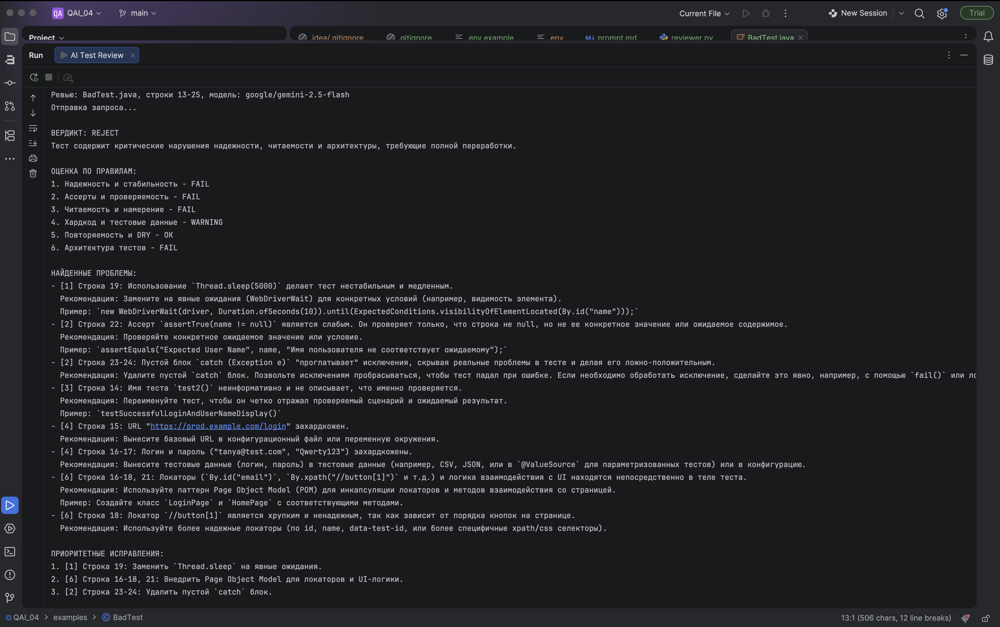

# AI Test Review для IntelliJ IDEA

Инструмент для код-ревью автотестов прямо в IntelliJ IDEA. Выделяешь фрагмент кода, нажимаешь горячую клавишу, и облачная модель через OpenRouter возвращает заключение по 6 правилам качества

## Правила качества

1. Надежность и стабильность тестов
2. Ассерты и проверяемость результата
3. Читаемость и намерение кода
4. Хардкод и тестовые данные
5. Повторяемость и DRY
6. Архитектура тестов

Критерии нарушений по каждому правилу и формат ответа описаны в [prompt.md](prompt.md)

## Как это работает

1. Пользователь выделяет код в редакторе IDEA и нажимает горячую клавишу
2. IDEA через External Tool запускает `reviewer.py` и передает путь к файлу и номера выделенных строк
3. Скрипт читает фрагмент с номерами строк и отправляет его в OpenRouter вместе с системным промптом
4. Заключение ревью выводится в консоль Run внизу IDE

## Формат заключения

- **Вердикт:** APPROVE / NEEDS CHANGES / REJECT с кратким обоснованием
- **Оценка по правилам:** OK / WARNING / FAIL для каждого из 6 правил
- **Найденные проблемы:** номер правила, строка, описание и рекомендация по исправлению
- **Приоритетные исправления:** топ-3 самых важных правки

## Структура репозитория

```
├── reviewer.py              # скрипт запроса к OpenRouter
├── prompt.md                # системный промпт с правилами и форматом ответа
├── .env.example             # шаблон для API-ключа и модели
├── .gitignore               # исключает .env с ключом
├── examples/
│   └── BadTest.java         # пример плохого теста для демонстрации
└── results_screenshots/
    └── review_test2.png     # пример результата ревью
```

## Требования

- IntelliJ IDEA
- Python 3.8+ (используется только стандартная библиотека, установка пакетов не нужна)
- Аккаунт и API-ключ [OpenRouter](https://openrouter.ai)

## Установка и настройка

### 1. Клонировать репозиторий

```
git clone https://github.com/tamakarowa/QAI_04.git
```

### 2. Добавить API-ключ

Скопировать `.env.example` в `.env` и вставить свой ключ OpenRouter:

```
OPENROUTER_API_KEY=sk-or-v1-...
OPENROUTER_MODEL=google/gemini-2.5-flash
```

Ключ создается на openrouter.ai в разделе **Keys**. Модель можно заменить на любую из каталога OpenRouter, в том числе бесплатные с суффиксом `:free`

Файл `.env` добавлен в `.gitignore` и не попадает в репозиторий

### 3. Проверить работу из терминала

```
python3 reviewer.py examples/BadTest.java
```

### 4. Подключить External Tool в IDEA

**Settings - Tools - External Tools - +**

| Поле | Значение |
|---|---|
| Name | `AI Test Review` |
| Program | путь к Python, узнать через `which python3` |
| Arguments | `"/полный/путь/к/reviewer.py" "$FilePath$" $SelectionStartLine$ $SelectionEndLine$` |
| Working directory | `$ProjectFileDir$` |

В Advanced Options оставить включенными **Synchronize files after execution** и **Open console for tool output**

### 5. Назначить горячую клавишу

**Settings - Keymap** - найти `AI Test Review` в разделе External Tools - **Add Keyboard Shortcut**

## Использование

1. Открыть файл с тестами в IDEA
2. Выделить фрагмент кода (если ничего не выделено, проверяется весь файл)
3. Нажать горячую клавишу или **Tools - External Tools - AI Test Review**
4. Прочитать заключение в консоли Run

## Пример результата

Ревью метода `test2` из [examples/BadTest.java](examples/BadTest.java):


